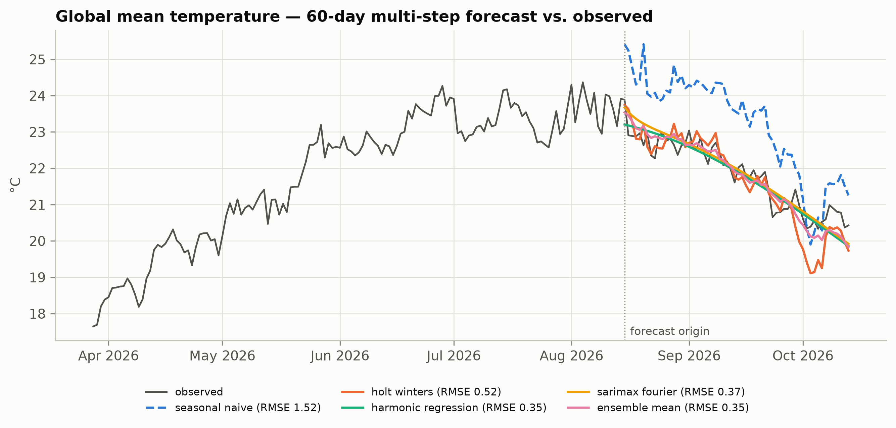
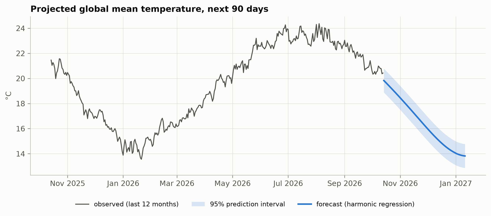
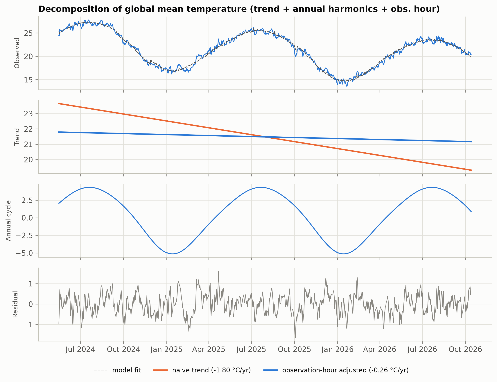
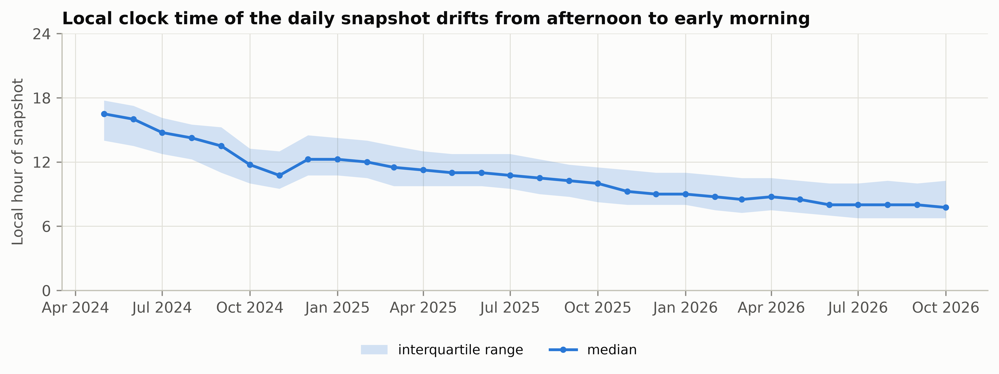
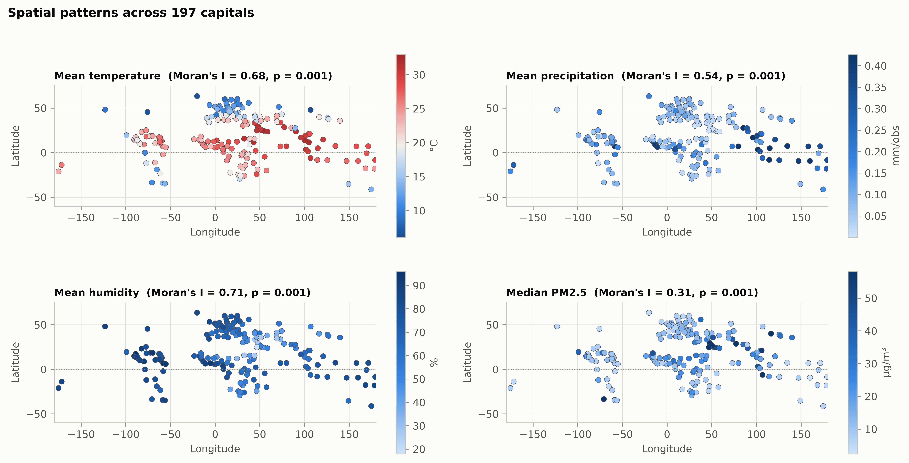
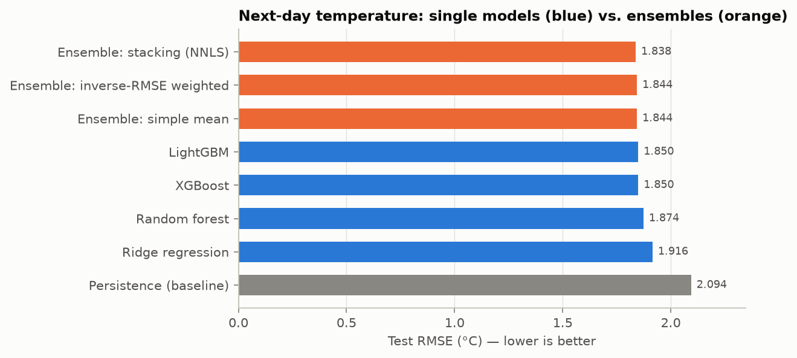
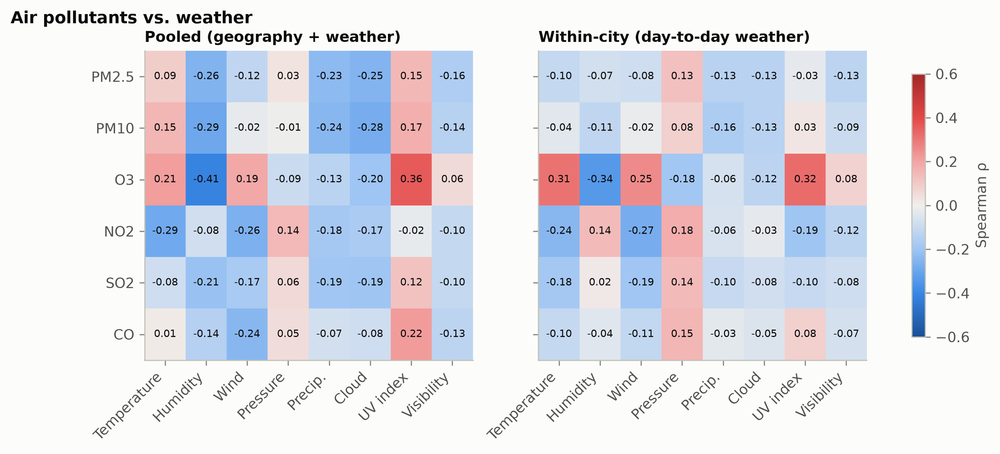
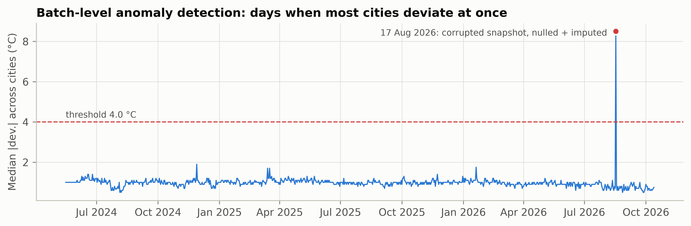
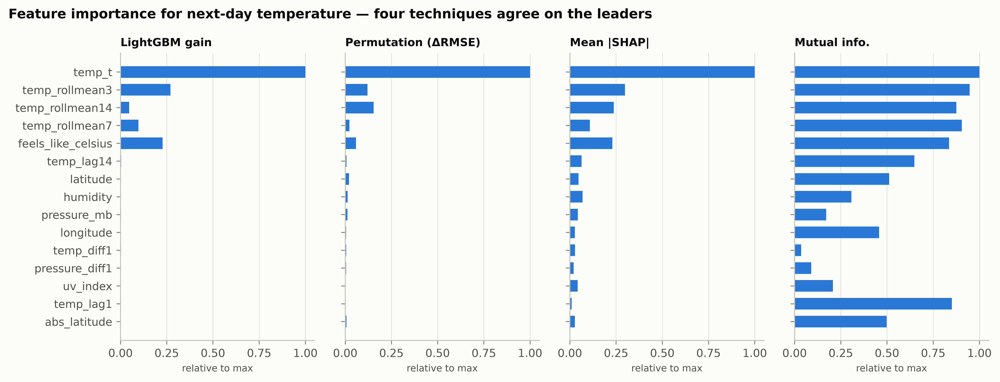

# Weather Trend Forecasting — Global Weather Repository

**PM Accelerator · Data Science Tech Assessment (Advanced track)**

> ### PM Accelerator mission
> PM Accelerator (Dr. Nancy Li) is a global community that helps aspiring and current product managers fast-track their careers through coaching, an AI Product Management bootcamp and hands-on product experience. Its non-profit arm, *PMA Kids*, offers free product-management education to teenagers from underserved families:
>
> *"Our mission is to break down financial barriers and achieve educational fairness. With the goal of establishing 200 schools worldwide over the next 20 years, we aim to empower more kids for a better future in their life and career, simultaneously fostering a diverse landscape in the tech industry."*
> — [pmaccelerator.io](https://www.pmaccelerator.io/)

This repository analyses the Kaggle [Global Weather Repository](https://www.kaggle.com/datasets/nelgiriyewithana/global-weather-repository): daily weather and air quality for the capital cities of the world, with 41 features. It forecasts future temperature and covers both the basic and the advanced assessment:

- data cleaning
- exploratory data analysis (EDA)
- anomaly detection
- multiple forecasting models and ensembles
- climate, air-quality, feature-importance, spatial and geographic analyses

Everything is one **reproducible pipeline**:

- **DVC** versions the data and models and chains the stages.
- **MLflow** tracks every stage and model and holds the model registry.
- **uv** manages the environment.
- **ruff + black** enforce code style through a pre-commit hook.

📄 **Full report:** [`reports/latex/main.pdf`](reports/latex/main.pdf). It is two-column, written in LaTeX with the Tau template (`reports/latex/tau-class/`), and its figures are vector PDFs generated by the pipeline.

---

## Headline results

| | |
|---|---|
| Data | 170,928 raw snapshots → **166,753 clean rows, 197 capitals, 186 countries**, 16 May 2024 – 13 Oct 2026 |
| Next-day temperature (all cities, 60-day test window) | **Stacked ensemble: RMSE 1.838 °C, MAE 1.21 °C, R² 0.929**, 12.2 % better than persistence |
| Global mean temperature, 60 days ahead | **RMSE 0.35 °C** (harmonic regression / SARIMAX / their ensemble), versus 1.52 °C for seasonal-naive |
| Key discovery | The local time of the daily snapshot drifts from **16:30 to 07:45**, which fakes a cooling of −1.8 °C/yr. Adjusting for it brings the trend to −0.26 °C/yr. |
| Data-quality catch | **17 Aug 2026 is a corrupted batch** (e.g. Riyadh at 15.6 °C in August). A batch-level detector finds it; it is nulled and re-imputed. |

### Next-day forecast: model comparison (test window, 11,213 city-days)

| Model | MAE | RMSE | R² | ≤ 2 °C | Skill vs persistence |
|---|---|---|---|---|---|
| Persistence (baseline) | 1.321 | 2.094 | 0.907 | 79.2 % | — |
| Ridge regression | 1.310 | 1.916 | 0.922 | 79.9 % | 8.5 % |
| Random forest | 1.229 | 1.874 | 0.926 | 80.7 % | 10.5 % |
| XGBoost | 1.225 | 1.850 | 0.928 | 81.1 % | 11.7 % |
| LightGBM | 1.220 | 1.850 | 0.928 | 81.1 % | 11.7 % |
| Ensemble: simple mean | 1.218 | 1.844 | 0.928 | 81.4 % | 12.0 % |
| Ensemble: inverse-RMSE weighted | 1.218 | 1.844 | 0.928 | 81.3 % | 12.0 % |
| **Ensemble: stacking (NNLS)** | **1.211** | **1.838** | **0.929** | **81.4 %** | **12.2 %** |

Stacking weights, learned on the validation window only: XGBoost 0.49, LightGBM 0.26, Ridge 0.24, random forest 0.01.

### Global mean temperature: 60-day multi-step forecast

| Model | MAE | RMSE |
|---|---|---|
| Naive | 2.077 | 2.275 |
| Seasonal naive (t − 365 days) | 1.412 | 1.522 |
| Holt–Winters (damped, 365-day season) | 0.402 | 0.517 |
| Harmonic regression (trend + Fourier + obs.-hour) | 0.275 | 0.355 |
| Regression with ARIMA(1,0,1) errors | 0.292 | 0.368 |
| **Mean ensemble** | **0.286** | **0.346** |

<p align="center">
  
  
</p>
<p align="center">
  
  
</p>

---

## Exploratory notebook
[`EDA/eda.ipynb`](EDA/eda.ipynb) walks through the **raw** data before any cleaning, and is the reasoning behind each cleaning decision:
- data types, sentinels and physically impossible values;
- location coverage and translated country names;
- the drift in snapshot hour, and the diurnal cycle it hides (snapshots at 14:00–15:00 read about +2 °C, at 07:00–09:00 about −2 °C);
- temperature, precipitation and other weather distributions, correlations and air quality;
- the corrupted 17 Aug 2026 batch, and a world map.

It ends with a table mapping each finding to its pipeline step. To open it, run `uv run jupyter lab EDA/eda.ipynb` (after `uv run dvc pull`).

## Methodology

### 1. Data cleaning & preprocessing — `src/weather/data/clean.py`, `data/features.py`
- **Schema.** Drop the 7 redundant imperial columns, parse `last_updated`, and keep the snapshot's **local hour** as a covariate.
- **Coverage.** Drop 71 one-off or mis-named locations with fewer than 365 days of data. Map translated country names (*Polônia*, Cyrillic, Chinese) back to each location's canonical name. Add continents via `pycountry-convert` plus overrides. Collapse 385 same-day duplicates.
- **Validity.** Values outside physical ranges become NaN (pressure 3,006 mb, wind 2,963 kph, sentinel −9999).
- **Corrupted batches.** If the median deviation across all cities from their 15-day rolling median exceeds 4 °C, that whole day is nulled.
- **Outliers.** Winsorise symmetric variables at a per-city 3×IQR fence and heavy-tailed variables (precipitation, pollutants) at the global 99.9th percentile. Each capped value keeps a flag.
- **Missing values.** Per-city time interpolation for gaps of up to 3 days, then the city median.
- **Normalisation.** A `StandardScaler` fitted on the **training window only** and persisted.
- **Features.** For a next-day target, using only information available at day *t*:
  - temperature lags (1, 2, 3, 7, 14 days), 3/7/14-day rolling means and standard deviations, day-on-day change;
  - current weather variables, plus changes in pressure and humidity;
  - annual and hemisphere-aware seasonal harmonics, and diurnal harmonics of the snapshot hour;
  - latitude, longitude and continent.
- **Split.** Strictly by date: last 60 days = test, the 60 days before = validation, the rest = train.

### 2. Exploratory data analysis — `analysis/eda.py`
- Temperature distributions and monthly curves per continent.
- Precipitation distribution: 67 % of snapshots are dry, and wet-day amounts are roughly log-normal.
- Continent × month precipitation heatmap and the wettest capitals.
- Spearman correlation matrix and weather-condition frequencies.
- **Harmonic-regression decomposition** of the global mean. STL is degenerate with only about 2.4 annual cycles.

### 3. Anomaly detection — `analysis/anomaly.py`
Anomalies are measured against each city's **own climate**: temperature against the city-and-month mean, other variables against the city mean.
- **Isolation Forest** (1 %) and **LOF** for unusual multivariate combinations. They are driven mainly by extreme precipitation, low visibility and humidity.
- **Temporal robust z-score** against a 15-day rolling median (2.6 % flagged).
- **Batch-level detector** for days when the data provider failed.
- Agreement between detectors is reported (Isolation Forest vs LOF Jaccard ≈ 0.11), along with a top-anomalies table.

### 4. Forecasting — `modeling/train.py`, `modeling/train_global.py`, `modeling/ensemble.py`
- **City panel, next-day forecast.**
  - Models: persistence, ridge, random forest, XGBoost and LightGBM (both with early stopping on validation).
  - Ensembles: mean, inverse-validation-RMSE weights, and NNLS **stacking**.
  - The stacked ensemble is logged and registered as an **MLflow pyfunc model** (`weather-temp-ensemble`). The pipeline checks that the served model reproduces the offline predictions.
- **Global series, 60-day multi-step forecast.**
  - Models: naive, seasonal-naive, Holt–Winters, harmonic regression, regression with ARIMA errors, and their ensemble.
  - The best model is refitted to project the **next 90 days with 95 % prediction intervals**.
- **Metrics.** MAE, RMSE, sMAPE, R², % within 2 °C, and skill against persistence. MAPE is computed only where |y| ≥ 1 °C, because it explodes near 0 °C.

### 5. Advanced analyses — `insights/`
- **Climate.** Per-city trend regressions, naive vs observation-hour adjusted. Latitude-band seasonality, where the hemispheres run in opposite phase. The annual range scales with |latitude| (r = 0.84); Ulaanbaatar has a 42 °C swing.
- **Environmental impact.** Pooled vs **within-city** correlations between pollutants and weather:
  - ozone tracks temperature and UV (ρ ≈ 0.31);
  - NO₂ and SO₂ fall with wind and rise with pressure;
  - PM2.5 is driven mostly by location. A LightGBM model gets R² ≈ 0.51, with UV, temperature and humidity the top weather drivers.
  - 41 % of capitals have a median PM2.5 above the WHO 24-hour guideline.
- **Feature importance.** LightGBM gain, permutation, **SHAP**, and mutual information. All four agree that persistence (current temperature and rolling means) dominates. Secondary drivers are humidity, pressure and its change, latitude, UV and the diurnal terms.
- **Spatial.** Moran's I with k-NN great-circle weights: temperature 0.68, humidity 0.71, precipitation 0.54, PM2.5 0.31, all with p = 0.001. Latitude profile with LOWESS. Interactive **Folium** and **Plotly** maps.
- **Geographic patterns.** Continent box plots, the hottest and coldest capitals (Doha 32.9 °C, Ulaanbaatar 6.1 °C), and continent and country summary tables.

<p align="center">
  
</p>
<p align="center">
  
  
</p>
<p align="center">
  
  
</p>

Interactive maps (open locally): [`reports/maps/capitals_weather_map.html`](reports/maps/capitals_weather_map.html), [`map_temperature.html`](reports/maps/map_temperature.html), [`map_pm25.html`](reports/maps/map_pm25.html), [`map_precip.html`](reports/maps/map_precip.html).

---

## Key insights
1. **Audit how the data was collected before fitting trends.** The drifting snapshot hour fakes a cooling of −1.8 °C/yr. Correcting for it also cuts the multi-step SARIMAX error by 40 % (0.62 → 0.37 °C).
2. **The source feed has failures of its own.** A whole-day corrupted batch is invisible to per-city outlier fences but obvious to a cross-city detector.
3. **Next-day temperature is mostly persistence.** Machine-learning models add about 12 % skill, and ensembles beat every single model.
4. **Global seasonal trends are highly predictable:** about 0.35 °C error 60 days ahead.
5. **Air quality is local.** Ozone follows heat and sunshine. PM2.5 is driven mostly by location and emissions rather than by daily weather.
6. **Climate has strong spatial structure,** and latitude sets the size of the seasonal cycle.

**Limitations.**
- About 2.4 years of data, so no long-term climate claims.
- One instantaneous snapshot per day, not daily means or extremes.
- Some API geocoding homonyms (e.g. "Yaren" in Türkiye). They are kept because their coordinates match the listed country.
- Pollutant values come from a model-based feed.

---

## Repository structure
```
├── .env                     # ALL configuration: paths, MLflow, data source, thresholds, split, lags, hyper-parameters
├── dvc.yaml / dvc.lock      # pipeline DAG + exact hashes of every input/output
├── pyproject.toml / uv.lock # environment (uv) + ruff/black/pytest config
├── .pre-commit-config.yaml  # ruff (lint+fix) + black (format) before every commit
├── src/weather/
│   ├── utils/
│   │   ├── config.py        # pydantic Settings (nested BaseModels) built from .env; cached get_settings(), MLflow setup
│   │   ├── plotting.py      # matplotlib style + palette helpers
│   │   ├── metrics.py       # regression metrics
│   │   └── mlflow_utils.py  # MLflow logging helpers
│   ├── data/
│   │   ├── download.py      # Kaggle download (kagglehub, REST fallback)
│   │   ├── clean.py         # validity, dedup, corrupted batches, outliers, imputation, continents
│   │   └── features.py      # daily panel, lags/rolling/calendar/diurnal features, split, scaler
│   ├── analysis/
│   │   ├── eda.py           # EDA figures
│   │   ├── anomaly.py       # Isolation Forest, LOF, temporal & batch-level detection
│   │   └── decomposition.py # harmonic decomposition of the global series (used by eda + anomaly)
│   ├── modeling/
│   │   ├── train.py         # next-day panel models (nested MLflow runs, registry)
│   │   ├── train_global.py  # multi-step global-series models + 90-day projection
│   │   ├── ensemble.py      # mean / weighted / stacking ensembles, pyfunc registration
│   │   └── ensemble_model.py# MLflow pyfunc wrapper for the ensemble
│   └── insights/            # stage `analyses` (entry point: run.py)
│       ├── common.py        # shared output dir + label dictionaries
│       ├── climate.py, air_quality.py, feature_importance.py, spatial.py, geographic.py
│       └── run.py           # runs every analysis, writes reports/metrics/analyses.json, logs to MLflow
├── tests/                   # pytest: cleaning rules, leakage-free features/split, metrics
├── EDA/eda.ipynb            # step-by-step exploratory notebook on the raw data (executed, outputs saved)
├── reports/
│   ├── figures/             # all figures (committed; DVC outputs with cache: false)
│   ├── tables/              # CSV + auto-generated LaTeX tables
│   ├── metrics/             # JSON metrics per stage (dvc metrics show)
│   ├── maps/                # interactive HTML maps
│   └── latex/               # report (Tau two-column layout): main.tex + sections/*.tex + tau-class/ → main.pdf
├── data/                    # DVC-tracked (git-ignored): raw / interim / processed
└── models/                  # DVC-tracked (git-ignored): scaler, models, ensemble config
```

## Reproducing

**Requirements:** [uv](https://docs.astral.sh/uv/), Python 3.12, and a Kaggle API token in `~/.kaggle/kaggle.json`. Static Plotly map export uses Google Chrome through kaleido and is skipped gracefully if Chrome is missing. Compiling the report needs LaTeX (`latexmk`).

```bash
uv sync                          # create .venv from uv.lock
uv run pre-commit install        # enable the ruff + black pre-commit hook

uv run dvc repro                 # run the whole pipeline (≈3 min): download → … → analyses
uv run dvc dag                   # show the DAG
uv run dvc metrics show          # all stage metrics
uv run dvc push                  # push data + models to the DVC remote

uv run mlflow ui --backend-store-uri sqlite:///mlflow.db   # http://127.0.0.1:5000
uv run pytest                    # tests

cd reports/latex && latexmk -pdf main.tex   # build the report
```

To pull the exact data and models instead of recomputing them, run `uv run dvc pull`. The default remote is a local folder (`../dvc-storage-weather`); point it at S3, GDrive or another store with `dvc remote modify localstore url <url>`. To experiment, change a value in `.env` (or override it with an environment variable such as `CLEAN__IQR_K=2.5`), then run `dvc repro` and compare runs with `dvc metrics diff` or in MLflow.

### Configuration
All settings live in [`.env`](.env) and are loaded by [`src/weather/utils/config.py`](src/weather/utils/config.py).
- `Settings` is a pydantic-settings model (a pydantic `BaseModel` that reads `.env`). Each section is its own nested `BaseModel`, filled from `SECTION__KEY` variables, and values are type-checked (for example `SPLIT__TEST_DAYS=0` is rejected).
- `get_settings()` builds the object once and caches it with `functools.lru_cache`.
- Example: `get_settings().models.lightgbm.num_leaves`, or `get_settings().paths.features_path`.
- Real environment variables override `.env`. `.env` is committed because it holds no secrets (the Kaggle token stays in `~/.kaggle`) and reproducing the pipeline depends on it.
- Every DVC stage depends on `.env`, so changing any setting reruns the pipeline.

### MLflow layout
- Experiment `weather-forecasting`: one run per stage (`clean`, `features`, `eda`, `anomaly`, `train_panel`, `train_global`, `ensemble`, `analyses`).
- Each model is a nested run with parameters, validation and test metrics, a residual plot, the model artefact, signature and input example.
- Registered models: `weather-temp-ridge`, `-random_forest`, `-xgboost`, `-lightgbm`, `-ensemble`.

### Code quality
`ruff` (pycodestyle, pyflakes, isort, bugbear, pyupgrade, simplify, numpy rules) and `black` (line length 120) are configured in `pyproject.toml`. The pre-commit hook runs both through `uv run`, so it uses the exact versions pinned in `uv.lock`. Run them by hand with `uv run ruff check --fix . && uv run black .`, or across the repo with `uv run pre-commit run --all-files`.
